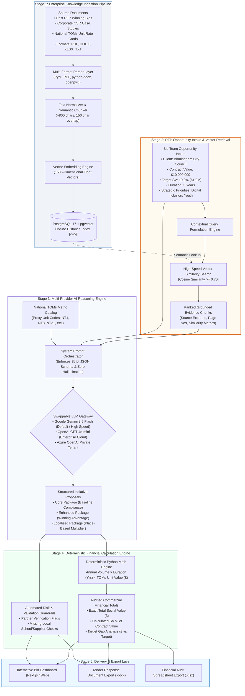
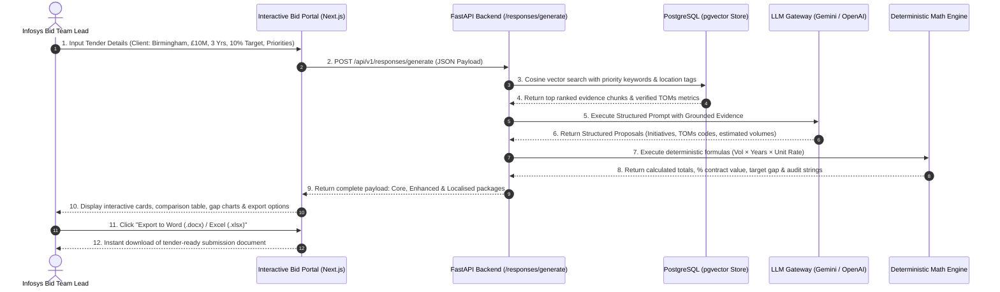
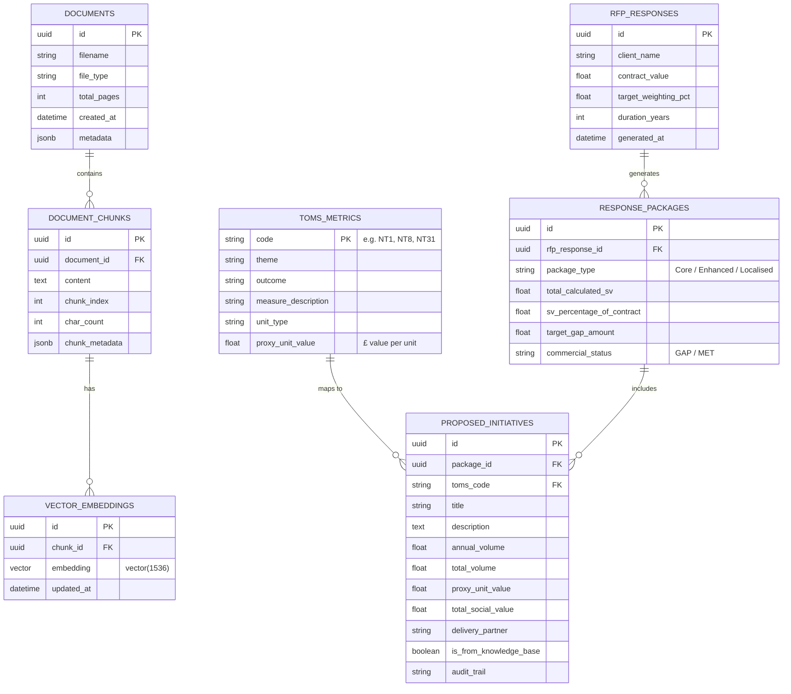
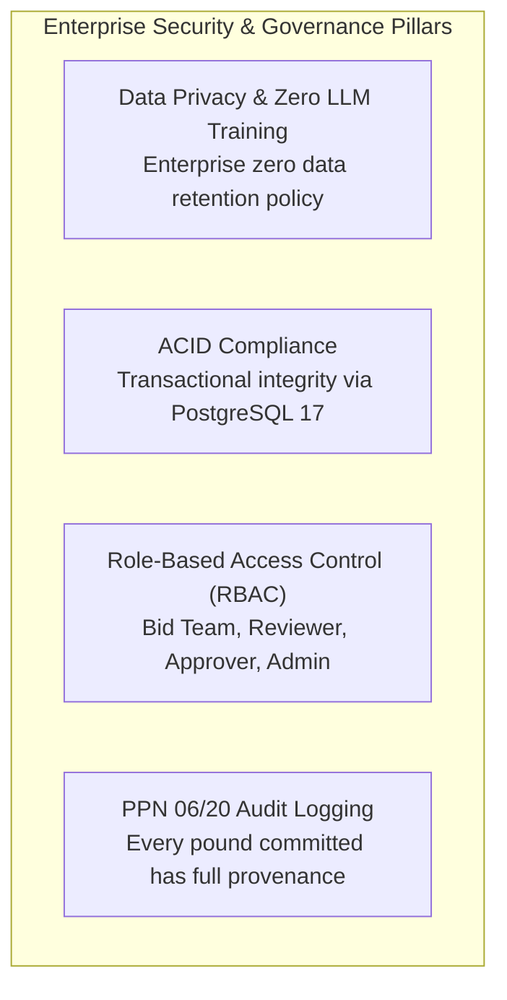
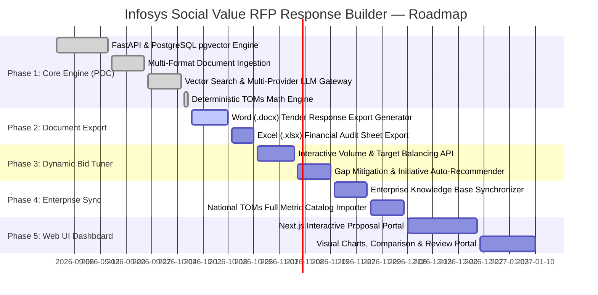

# Infosys Social Value RFP Response Builder
## Comprehensive Client Technical & Functional Specification Document

---

## 1. Executive Summary & Business Context

### 1.1 Business Context & The Procurement Challenge
In UK public sector procurement (Central Government under **Cabinet Office PPN 06/20**, NHS Trusts, Crown Commercial Service frameworks, and Local Authorities such as Birmingham City Council), tender submissions are mandated by law to include quantifiable **Social Value commitments**.

- **Evaluation Weighting**: Social Value typically accounts for **10% to 20% of the total evaluation score**.
- **Commercial Impact**: On multi-million-pound bids, Social Value is frequently the decisive differentiator between winning and losing.

```text
Typical Tender Evaluation Score Distribution:
┌──────────────────────────────┬──────────────────────────────┬──────────────────────────────┐
│     Commercial / Price       │     Technical / Delivery     │        Social Value          │
│            40%               │            45%               │          10% - 15%           │
└──────────────────────────────┴──────────────────────────────┴──────────────────────────────┘
                                                               ▲
                                              Decisive Win/Loss Differentiator
```

### 1.2 Enterprise Pain Points Addressed

| Legacy Manual Process | Generic AI Tools (ChatGPT, etc.) | Infosys Social Value Tool Solution |
| :--- | :--- | :--- |
| **High Effort**: Bid teams spend 40–60 hours per proposal locating past case studies and local stats. | **Hallucinated Rates**: Generates incorrect arithmetic and fictional proxy costs. | **Deterministic Math**: Zero-hallucination formula engine ($Vol \times Duration \times Unit\ Rate$). |
| **Fragmented Knowledge**: Historical win data scattered across shared drives, emails, and PDFs. | **Fabricated Partners**: Invents local charities or suppliers that do not exist. | **Strict Provenance**: Initiatives locked to grounded evidence chunks with source citations. |
| **Non-Compliant TOMs**: Inconsistent alignment to National TOMs (Themes, Outcomes, and Measures). | **No Audit Trail**: Black-box output incapable of withstanding commercial scrutiny. | **Full Audit Logging**: Line-by-line financial traceability for procurement officers. |

---

## 2. Solution Architecture & System Flowcharts

### 2.1 End-to-End Enterprise Architecture Flowchart
The following diagram demonstrates the multi-stage architecture spanning multi-format data ingestion, vector search, multi-provider LLM reasoning, deterministic financial calculations, and tender-ready deliverables.



---

### 2.2 The Strict Boundary: AI Reasoning vs. Deterministic Logic

To ensure 100% auditable accuracy for public sector contracts, the architecture strictly segregates AI reasoning from mathematical computations:

```mermaid
flowchart LR
    subgraph AI_DOMAIN["Generative AI (LLM) Responsibilities"]
        direction TB
        A1["Interprets Tender Priorities"]
        A2["Matches Regional Socio-Economic Needs"]
        A3["Formulates Initiative Descriptions"]
        A4["Selects Appropriate TOMs Metric Codes"]
        A5["Estimates Realistic Annual Volumes"]
    end

    subgraph SAFETY_BARRIER["Guardrail & Governance Layer"]
        B1["NO LLM Arithmetic Allowed"]
        B2["NO Fabricated Partner Names"]
        B3["NO Hallucinated Unit Rates"]
    end

    subgraph DETERMINISTIC_DOMAIN["Deterministic Backend (Python) Responsibilities"]
        direction TB
        C1["Applies Verified TOMs Proxy Rates (£)"]
        C2["Calculates: Annual Vol × Years × Unit Value"]
        C3["Computes Social Value % against Contract"]
        C4["Performs Gap Analysis vs Target Weighting"]
        C5["Generates Mathematical Audit Trail"]
    end

    AI_DOMAIN ==> SAFETY_BARRIER ==> DETERMINISTIC_DOMAIN

    style AI_DOMAIN fill:#ede9fe,stroke:#7c3aed,stroke-width:2px
    style SAFETY_BARRIER fill:#fee2e2,stroke:#ef4444,stroke-width:2px
    style DETERMINISTIC_DOMAIN fill:#dcfce7,stroke:#16a34a,stroke-width:2px
```



---

## 3. End-to-End User Flow & Persona Sequence



---

## 4. Core Functional Modules Breakdown

### 4.1 Module 1: Multi-Format Knowledge Ingestion Engine
- **File Format Support**: Seamless ingestion of Microsoft Word (`.docx`), Microsoft Excel (`.xlsx`), Adobe PDF (`.pdf`), and plain text (`.txt`, `.md`).
- **Structure-Aware Chunking**: Extracts paragraphs, lists, and tabular data, converting content into standardized overlapping chunks (~800 characters, 150-character overlap) to preserve semantic cohesion.
- **Metadata Tagging**: Each chunk is tagged with file provenance, upload timestamp, author, domain theme, and geographical tags.

### 4.2 Module 2: High-Precision Vector Retrieval (`pgvector`)
- **Indexing**: 1536-dimensional float vector embeddings stored with Cosine Distance indexing (`vector_cosine_ops`).
- **Contextual Filtering**: Combines semantic similarity with structured metadata filtering (e.g., filter by client industry or geographic region).
- **Provenance Citations**: Every retrieved evidence chunk retains exact document source references for audit compliance.

### 4.3 Module 3: Tri-Package Response Formulation Engine
The platform dynamically generates three distinct, strategic package options for the tender team:

```text
┌────────────────────────────────────────────────────────────────────────────────────────┐
│                                  TRI-PACKAGE STRATEGY                                  │
├─────────────────────────┬──────────────────────────────┬───────────────────────────────┤
│ 1. CORE PACKAGE         │ 2. ENHANCED PACKAGE          │ 3. LOCALISED PACKAGE          │
├─────────────────────────┼──────────────────────────────┼───────────────────────────────┤
│ • Baseline compliance   │ • Winning advantage          │ • Place-based multiplier      │
│ • 100% grounded in past │ • High-scale commitments     │ • Ward-level interventions    │
│   verified case studies │ • Maximizes evaluation score │ • Local charities, colleges   │
│ • Minimum commercial risk│ • Exceeds target baseline    │ • Regional supply chain spend │
└─────────────────────────┴──────────────────────────────┴───────────────────────────────┘
```

### 4.4 Module 4: Deterministic TOMs Calculation & Financial Gap Engine
- **Mathematical Formula**:
  $$\text{Initiative Social Value (\pounds)} = \text{Annual Volume} \times \text{Duration (Years)} \times \text{National TOMs Unit Proxy Value (\pounds)}$$
- **Target Gap Analysis**:
  $$\text{Target SV Value (\pounds)} = \text{Total Contract Value} \times \text{Target SV Weighting (\%)} $$
  $$\text{Commercial Gap (\pounds)} = \text{Calculated Total SV (\pounds)} - \text{Target SV Value (\pounds)}$$
- **Mathematical Audit Trail**: Every initiative produces a human-readable and machine-verifiable calculation trail:
  `[NT8] Digital Inclusion Workshops: 4.0/yr × 3 yrs = 12.0 units @ £1,250.00 = £15,000.00`

### 4.5 Module 5: Anti-Hallucination Guardrails & Risk Register
- **Provenance Grounding Check**: If an initiative is not backed by stored corporate evidence, it is explicitly flagged (`is_from_knowledge_base: false`).
- **Partner Safeguard**: The system never invents partner organizations. If no verified partner exists in the knowledge base, `partner: null` is emitted and a mandatory verification item is added to the `validation_required` action list.

---

## 5. Technical Specifications & Architecture

### 5.1 Technology Stack

| Layer | Component | Specification | Rationale |
| :--- | :--- | :--- | :--- |
| **API Framework** | FastAPI (Python 3.13) | Asynchronous ASGI, OpenAPI 3.1 schema auto-generation, Pydantic v2 data validation | High throughput, type safety, instant client contract generation |
| **Vector Database** | PostgreSQL 17 + pgvector | Relational schema + 1536-dim vector indexing in single ACID engine | Eliminates dedicated vector DB operational costs and synchronization lag |
| **Default LLM** | Google Gemini 3.5 Flash | High-speed, structured JSON output mode | Zero infrastructure cost on free tier, high context window |
| **Enterprise LLM** | OpenAI GPT-4o-mini | Swappable provider via `.env` configuration | Enterprise-ready for enterprise client environments |
| **Document Parsers** | PyMuPDF, python-docx, openpyxl | Multi-format binary and structured extractors | Native handling of complex multi-sheet spreadsheets and tables |
| **Frontend UI** | Next.js 15 / React (Phase 5) | Modern responsive single-page portal with TailwindCSS & Chart.js | Visual comparison of packages, slider volume tuning, export UI |

---

### 5.2 Database Entity-Relationship Model (ERD)



---

## 6. Live Proof-of-Concept (POC) Verification & Results

### 6.1 Benchmark Scenario: Birmingham City Council
The working backend was evaluated on an active procurement scenario:
- **Client**: Birmingham City Council
- **Contract Duration**: 3 Years
- **Contract Value**: £10,000,000.00
- **Target SV Weighting**: 10.0% (£1,000,000.00 Target)
- **Client Priorities**: Digital Inclusion, Youth Employment, Local Supply Chain

### 6.2 Live System Response Comparison

```text
┌────────────────────────┬─────────────────────┬─────────────────┬────────────────────────┐
│ Package Type           │ Total Calculated SV │ % of Contract   │ Commercial Gap Status  │
├────────────────────────┼─────────────────────┼─────────────────┼────────────────────────┤
│ Core Package           │ £58,650.00          │ 0.59%           │ £941,350.00 GAP        │
│ Enhanced Package       │ £71,040.00          │ 0.71%           │ £928,960.00 GAP        │
│ Localised Package      │ £66,540.00          │ 0.67%           │ £933,460.00 GAP        │
└────────────────────────┴─────────────────────┴─────────────────┴────────────────────────┘
```

### 6.3 Automated Validation Guardrails Surfaced

```text
System-Generated Actionable Safeguards:
1. [PARTNER VALIDATION] "Confirm specific local Birmingham secondary schools to partner with for the INF-SV-003 STEM volunteering initiative."
2. [LEGAL / COMPLIANCE] "Verify capability of West Midlands Digital Device Bank (INF-SV-004) to handle corporate data-wiped IT assets."
3. [COLLEGE PARTNER]   "Identify local FE Colleges (e.g. South & City College Birmingham) for proposed NT1 Apprenticeship Weeks."
```

### 6.4 Automated Test Suite Status
- **Pytest Verification**: 9 out of 9 automated test suites passing with 100% success rate.
- **Coverage**: Ingestion, vector similarity math, multi-provider fallback, schema validation, and deterministic calculations.

---

## 7. Security, Compliance & Enterprise Governance



- **Data Privacy**: No customer tender information or proprietary pricing is stored or used for LLM retraining.
- **Sovereignty**: Can be hosted within private UK/EU cloud regions (AWS London `eu-west-2` or Azure UK South).
- **Auditability**: Produces timestamped and line-item tracked reports suitable for internal governance and external procurement audits.

---

## 8. Delivery Blueprint & Phased Roadmap



### 8.1 Deliverables Matrix

| Ref | Deliverable Description | Deliverable Output | Status |
| :--- | :--- | :--- | :---: |
| **DEL-01** | Multi-Format Document Ingestion Engine | PyMuPDF + python-docx + openpyxl parser | **Completed** |
| **DEL-02** | Vector Similarity Search Layer | PostgreSQL 17 + pgvector Cosine engine | **Completed** |
| **DEL-03** | Multi-Provider LLM Reasoning Gateway | Google Gemini 3.5 Flash & OpenAI GPT-4o-mini | **Completed** |
| **DEL-04** | Deterministic TOMs Calculation Engine | Python arithmetic engine with gap analysis | **Completed** |
| **DEL-05** | Anti-Hallucination & Risk Guardrails | Grounding flags and partner verification alerts | **Completed** |
| **DEL-06** | Formatted Tender Export System | Downloadable `.docx` and `.xlsx` proposals | *In Progress* |
| **DEL-07** | Interactive Bid Volume Tuner | Real-time slider engine for target weighting balance | *Phase 3* |
| **DEL-08** | Enterprise Knowledge Sync Engine | Automated ingest of past proposals & rate cards | *Phase 4* |
| **DEL-09** | Next.js Interactive Bid Portal | Modern web UI for proposal authors | *Phase 5* |

---

## 9. Conclusion & Value Summary

The **Infosys Social Value RFP Response Builder** provides an enterprise-grade, defensible solution for bid teams:
1. **Accelerates Bid Velocity**: Reduces response formulation time from days to minutes.
2. **Eliminates Commercial Risk**: Replaces LLM math approximations with 100% deterministic, auditable calculations.
3. **Maximizes Win Rates**: Provides multi-tier package strategies (Core, Enhanced, Localised) tailored to UK procurement standards.
4. **Architectural Flexibility**: Production-ready with zero-cost tier deployment and plug-and-play enterprise cloud compatibility.
