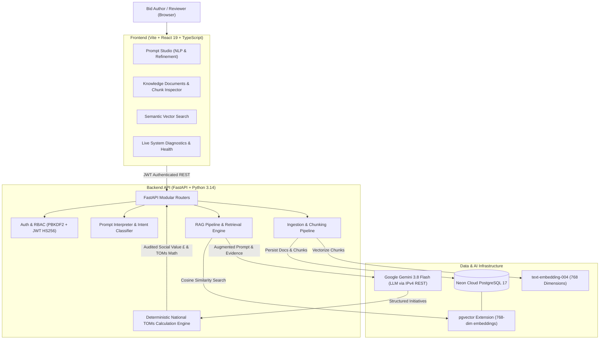
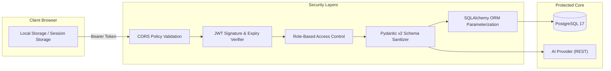

# Social Value RFP Response Engine: Enterprise System Architecture, Feature Reference & Functional Testing Manual

> [!IMPORTANT]
> **Document Purpose:** This document serves as the authoritative, permanent reference manual for the **Social Value RFP Response Engine**. It details system architecture, all implemented frontend/backend utilities with real-world scenarios, anti-hallucination mathematical integrity, security controls, and a complete, step-by-step **Functional Testing Manual** for quality assurance and stakeholder verification.

---

## 1. Executive Summary & System Architecture

The **Social Value RFP Response Engine** is an enterprise-grade, RAG-powered (Retrieval-Augmented Generation) decision-support platform designed to build compliant, auditable, and place-based Social Value bids for UK public sector procurements (such as NHS Trusts, City Councils, and Central Government tenders under PPN 06/20).



### Key Technical Specifications
| Layer | Technology | Role |
| :--- | :--- | :--- |
| **Frontend Framework** | React 19, TypeScript, Vite | Fast, typed, modular single-page application |
| **Design System** | Custom Vanilla CSS Design System | Responsive, zero-bloat, dark/light theme tokens |
| **Backend Framework** | FastAPI (Python 3.14) | Asynchronous, auto-documenting OpenAPI REST services |
| **Primary Database** | PostgreSQL 17 on Neon Cloud | ACID relational storage for users, documents, chunks, prompts |
| **Vector Engine** | `pgvector` v0.8.0 extension | Native cosine distance (`<=>`) vector similarity search |
| **LLM Inference** | Google Gemini 3.8 Flash | Ultra-fast tender classification, parameter extraction & drafting |
| **Embeddings** | Google `text-embedding-004` | 768-dimensional dense vector embeddings |
| **Network Optimization** | Windows IPv4-First Socket Patch | Eliminates 20-30s IPv6 blackhole timeouts on Windows hosts |
| **Security Standard** | PBKDF2-HMAC-SHA256, JWT, RBAC | Salaried password hashing, stateless sessions, role separation |

---

## 2. Implemented Features & Business Scenarios

### Feature 1: Natural Language Prompt Studio & Auto-Extraction
- **Description:** Bid writers do not need to fill out complex 15-field forms. They simply paste or type their natural language tender brief into Prompt Studio.
- **Backend Utility:** `POST /responses/prompt` runs `prompt_interpreter_service.interpret_and_execute()`.
- **Capabilities:**
  - Detects tender intent vs non-RFP chatter.
  - Automatically extracts: `client`, `location`, `contract_value_gbp`, `contract_duration_years`, `social_value_weighting_percent`, and key priorities (e.g. "Digital Inclusion", "Youth Apprenticeships").
  - Executes pgvector retrieval and synthesizes three distinct tender packages:
    1. **Template 1: Core Package (Baseline Compliance)** — Low-risk, mandatory criteria.
    2. **Template 2: Enhanced Package (Winning Advantage)** — Differentiating CSR initiatives.
    3. **Template 3: Localised Package (Exact Target Match)** — Calibrated to match the tender SV weighting.

#### Business Scenario 1: Birmingham City Council Bid Submission
- **Input Prompt:**
  ```text
  "I need to build a Social Value bid response, for a 3-year contract of £10M with 10% Social Value weighting. The client Birmingham City Council in Birmingham wants the Social Value offer to address digital inclusion and youth employment."
  ```
- **What Happens Under the Hood:**
  1. Backend extracts: Value = £10,000,000, Duration = 3 yrs, Weighting = 10% (Target SV = £1,000,000).
  2. Queries pgvector for chunks tagged with "Birmingham", "Digital Inclusion", "Youth".
  3. Retrieves chunks from `Infosys_Birmingham_Digital_Inclusion.docx`.
  4. Generates initiatives with operational delivery mechanisms and partners (e.g. East Birmingham College, St Basils).
  5. The Deterministic Math Engine calculates annual volume $\times$ duration $\times$ National TOMs proxy rate (£1,250 for NT8).
  6. The UI renders the **RAG Knowledge Grounding Audit Strip** showing retrieved chunks and filenames.

---

### Feature 2: Context-Aware Multi-Turn Conversational Refinement
- **Description:** RFP bids are rarely accepted on the first draft. Clients have feedback, local priorities shift, or commercial managers request adjustments. The tool provides continuous, context-aware conversational refinement.
- **Backend Utility:** `POST /responses/refine` with `conversation_turns: [{role, content}]`.
- **Capabilities:**
  - Preserves entire previous conversational thread and earlier instructions.
  - Never forgets original tender parameters (contract value, client, location) when updating initiatives.
  - Saves differential snapshots in audit history (`prompt_history` table).

#### Business Scenario 2: Iterative Bid Calibration
- **Turn 1 (Initial):** User generates bid for Birmingham (£10M, 10%).
- **Turn 2 (Refinement):** User submits:
  ```text
  "Increase youth apprenticeship weeks by 20% and add voluntary sector volunteering hours for local community libraries in Ward End."
  ```
- **What Happens Under the Hood:**
  The LLM receives the previous packages, the original prompt, and the new user constraint. It adjusts the relevant initiative volumes, maps volunteering hours to National TOMs code `NT12` (£21.00/hr), and recalculates the SV percentage without resetting the contract duration or client context.

---

### Feature 3: Document Ingestion, Chunking & Drag-and-Drop
- **Description:** Organizations can upload historical winning proposals, local CSR case studies, and framework rate cards (PDF, DOCX, XLSX, TXT, MD).
- **Backend Utility:** `POST /documents/ingest` in `app/api/documents.py`.
- **Capabilities:**
  - Drag-and-drop file ingestion zone with hover highlights and progress tracking.
  - Multi-file batch processing.
  - Text extraction, normalized sentence boundary chunking (500-1000 tokens).
  - 768-dimensional dense vector embedding generation via Google `text-embedding-004`.
  - Immediate persistence into PostgreSQL table `document_chunks` with `pgvector` indexing.

---

### Feature 4: Document Chunk Inspector (PostgreSQL Transparency)
- **Description:** Solves the black-box problem of RAG systems. Bid reviewers can inspect the exact text chunks extracted from their uploaded documents.
- **Backend Utility:** `GET /documents/{document_id}/chunks`.
- **Capabilities:**
  - "View Chunks" button on every document in `Documents.tsx`.
  - Modal drawer listing:
    - Chunk numbering (`Chunk #1`, `Chunk #2`, etc.)
    - Word count & page number metadata
    - Exact text content stored in PostgreSQL
    - Real-time text search filter across document chunks
    - Single-click "Copy Chunk" button

---

### Feature 5: Targeted Semantic Vector Search
- **Description:** Allows technical and bid teams to independently test pgvector retrieval without triggering LLM generation.
- **Backend Utility:** `POST /search` supporting `query`, `top_k`, and optional `document_id`.
- **Capabilities:**
  - **Document Scope Filter:** Search across "All Documents" or restrict search to a single document.
  - **Cosine Similarity Scores:** Percentage match pill (e.g. `Similarity: 94%`).
  - **Quick Suggestions:** Pre-configured query tags for rapid testing.

---

### Feature 6: Live System Diagnostics & Provider Verification
- **Description:** Directly answers the user question: *"Is PostgreSQL working or is it SQLite? Which AI model is running?"*
- **Backend Utility:** `GET /health`.
- **Capabilities:**
  - Live Sidebar pill displaying database engine and AI provider.
  - **System Health & Diagnostics Modal** detailing:
    - Database Engine: `PostgreSQL (Neon Cloud)` vs SQLite.
    - `pgvector` Extension: Status and version (e.g., `v0.8.0`).
    - Vector Dimensions: `768 dimensions`.
    - AI Provider: `gemini` (`gemini-3.8-flash` via direct REST IPv4).

---

### Feature 7: Anti-Hallucination & Math Integrity Architecture
- **Description:** In public sector bids, fabricating false statistics, non-existent charities, or fake financial numbers leads to immediate tender disqualification.
- **Architecture Rules:**
  1. **Strict Division of Labor:** The LLM only proposes initiatives, themes, target beneficiaries, and annual volumes. The LLM is **forbidden** from multiplying numbers or declaring final Social Value pound figures.
  2. **Authoritative Calculation Layer:** Pure Python deterministic math computes:
     $$\text{Total SV (\pounds)} = \sum (\text{Annual Volume} \times \text{Duration Years} \times \text{Unit TOMs Rate \pounds})$$
  3. **Zero-Mock Policy:** All client-side fake fallback catches have been removed. If an upload or LLM call fails, an honest **Anti-Hallucination Error Card** surfaces with real server diagnostics rather than synthetic results.

---

## 3. Security Architecture & Enterprise Hardening Roadmap

### Implemented Security Controls



1. **Backend-Managed Secrets:** No API keys are ever transmitted to or requested from the client.
2. **Password Cryptography:** Passwords hashed with PBKDF2-HMAC-SHA256 (100,000 rounds + random salt).
3. **Stateless JWT Authorization:** Signed tokens with `HS256` algorithms and strict expiration timestamps.
4. **Role-Based Access Control (RBAC):** Three distinct privilege tiers:
   - `superadmin`: Full administrative access, document deletion, user provisioning.
   - `bid_author`: Prompt execution, refinement, document upload, vector search.
   - `reviewer`: Read-only audit access to proposals and audit histories.
5. **SQL Injection Prevention:** 100% of database queries use SQLAlchemy parameterized filters; zero raw SQL concatenation.
6. **Upload Whitelist:** Only approved tender formats allowed (`.pdf, .docx, .doc, .xlsx, .xls, .txt, .md`).
7. **Soft-Delete RAG Isolation:** Archived documents have their chunks excluded from cosine searches, preventing stale data leakage.

### Enterprise Security Hardening Roadmap (Recommended Next Steps)
1. **API Rate Limiting (`slowapi`):** Enforce 5 login attempts/min and 15 prompt submissions/min per IP to prevent DoS attacks.
2. **Hard File-Size Limit:** Restrict uploads to a strict 25MB ceiling to prevent Out-Of-Memory exhaustion.
3. **HTTP-Only Secure Cookies:** Transition JWT storage from `localStorage` to `HttpOnly; SameSite=Strict; Secure` cookies for XSS immunity.
4. **LLM Prompt Injection Shield:** Implement pre-flight heuristic checks to detect and drop prompt injection attempts (e.g. *"Ignore previous instructions"*).
5. **SOC2 / ISO 27001 Audit Logs:** Maintain an immutable audit table tracking every generation event with user ID, IP address, and documents accessed.

---

## 4. End-to-End Functional Testing Manual

This section provides step-by-step test suites that any QA engineer, developer, or stakeholder can follow to verify the platform.

---

### Test Suite 1: Live System Diagnostics & DB Verification
- **Objective:** Verify that the application is running against Neon Cloud PostgreSQL (not SQLite) and that Gemini 3.8 Flash is active.
- **Preconditions:** Backend running on port 8000, Frontend running on port 5173.
- **Steps:**
  1. Open the application in a web browser: `http://localhost:5173`.
  2. Observe the bottom of the left sidebar.
  3. Verify that the status dot is green with text **"FastAPI Connected"**.
  4. Verify that the secondary lines state:
     - `DB: PostgreSQL (pgvector)`
     - `AI: gemini-3.8-flash`
  5. Click directly on the status card.
- **Expected Result:**
  - The **System Health & Diagnostics Modal** opens.
  - "Vector Database Engine" displays `PostgreSQL (Neon Cloud)` and `pgvector Installed (v0.8.0)`.
  - "LLM & Embedding Provider" displays `gemini-3.8-flash` with `Direct REST (IPv4 Fast-Path)`.
  - Anti-Hallucination Integrity shows active badge.
- **Pass / Fail Criteria:** PASS if all indicators show PostgreSQL and Gemini 3.8 Flash online.

---

### Test Suite 2: Natural Language Prompt Generation (Valid RFP Bid)
- **Objective:** Verify that a standard UK public tender prompt is parsed, grounded in vector evidence, and calculated deterministically.
- **Steps:**
  1. Click **"Prompt Studio"** in the sidebar.
  2. In the prompt text area, paste the following prompt:
     ```text
     I need to build a Social Value bid response, for a 3-year contract of £10M with 10% Social Value weighting. The client Birmingham City Council in Birmingham wants the Social Value offer to address digital inclusion and youth employment.
     ```
  3. Click **"Submit Tender Specification"** (or press `Enter`).
  4. Wait for generation (~40-50 seconds for deep live RAG & calculation).
- **Expected Result:**
  - Three KPI summary cards appear:
    - **Contract Value:** £10,000,000 over 3 Years.
    - **Target Commitment:** £1,000,000 (10.00%).
    - **Selected Package Status:** Target Achieved or status pill with calculated percentage.
  - **RAG Knowledge Grounding Audit Strip** appears showing retrieved chunks from PostgreSQL and verified filenames (e.g. `Infosys_Birmingham_Digital_Inclusion.docx`).
  - Three tabs are available: `Core (Baseline)`, `Enhanced (Winning Advantage)`, `Localised (Exact Match)`.
  - Each initiative displays:
    - Title, theme, delivery mechanism, target beneficiaries.
    - **"📄 Evidence: [Document Filename]"** badge.
    - **"✓ Case Study Grounded"** badge if retrieved from knowledge base.
    - **Deterministic Formula Trail** (e.g. `4 annual × 3 yrs @ £1,250 = £15,000`).
- **Pass / Fail Criteria:** PASS if packages generate with real evidence citations and audited formula trails.

---

### Test Suite 3: Irrelevant / Malicious Non-RFP Prompt Rejection
- **Objective:** Verify that random chat or prompt injection does not hallucinate fake bids.
- **Steps:**
  1. Click **"New Prompt"** in the sidebar.
  2. Enter the following prompt:
     ```text
     Tell me a recipe for chocolate cake and write a poem about autumn leaves.
     ```
  3. Click **"Submit Tender Specification"**.
- **Expected Result:**
  - The system detects non-RFP intent.
  - A friendly guidance card appears:
    - **"Non-Tender / General Prompt Detected"**
    - Explanation: *"The submitted input does not contain recognized tender specifications..."*
    - Suggested template provided with a "Use Sample Tender Prompt" button.
    - **Zero fake packages or synthetic numbers are generated.**
- **Pass / Fail Criteria:** PASS if non-tender prompts are safely intercepted without generating false bids.

---

### Test Suite 4: Multi-Turn Conversational Refinement
- **Objective:** Verify that the AI refines an existing bid while remembering previous turns.
- **Preconditions:** Successful result from Test Suite 2 is loaded on screen.
- **Steps:**
  1. Scroll down to the **"Refine & Guide Response (Multi-Turn Conversation)"** panel.
  2. Click the panel header to expand the refinement drawer.
  3. Enter the following instruction:
     ```text
     Increase the digital clinics frequency and add dedicated digital literacy workshops for elderly citizens in East Birmingham.
     ```
  4. Click **"Apply Refinement"**.
- **Expected Result:**
  - A subtle refinement banner appears: `Refined based on feedback: "Increase the digital clinics frequency..."`.
  - Conversation turn counter updates to `Turn 2`.
  - The initiatives update with increased digital clinic volume.
  - The overall Social Value pound value and percentage update deterministically.
  - Contract duration (3 years) and contract value (£10M) remain strictly preserved.
- **Pass / Fail Criteria:** PASS if the proposal updates intelligently without forgetting baseline parameters.

---

### Test Suite 5: Drag-and-Drop Document Ingestion
- **Objective:** Verify that real documents can be uploaded via drag-and-drop and indexed into PostgreSQL.
- **Steps:**
  1. Click **"Knowledge Documents"** in the sidebar.
  2. Create a test file on your computer: `Sample_Tender_Evidence.txt` with content:
     ```text
     Infosys Coventry Digital Hub delivered 12 Cyber Security introductory workshops for West Midlands school leavers in 2024, creating pathways for 24 young apprentices.
     ```
  3. Drag `Sample_Tender_Evidence.txt` and drop it directly onto the upload zone.
  4. Observe visual drag highlight and upload progress message.
- **Expected Result:**
  - Progress status shows: `Processing and vectorizing "Sample_Tender_Evidence.txt"...`.
  - Success banner appears: `"Sample_Tender_Evidence.txt" successfully indexed into pgvector!`.
  - The document appears in the **Indexed Document Repository** table with chunk count $\ge 1$.
- **Pass / Fail Criteria:** PASS if the file appears in the active document table with valid chunks.

---

### Test Suite 6: Document Chunk Inspector
- **Objective:** Verify that users can audit the exact text chunks of any document in PostgreSQL.
- **Preconditions:** At least one document in the repository.
- **Steps:**
  1. In **"Knowledge Documents"**, find `Sample_Tender_Evidence.txt` (or any existing file).
  2. Click the **"View Chunks"** button on that row.
- **Expected Result:**
  - The **Chunk Inspector Modal** opens.
  - Displays document filename, total chunks count, and format tag.
  - Displays `Chunk #1` with word count and full extracted text.
  - Type a keyword into the modal search bar (e.g. `Cyber Security`).
  - Verify that matching chunks filter in real-time.
  - Click **"Copy"** on a chunk card; verify button switches to `✓ Copied`.
  - Click **"Close"** or press `ESC`.
- **Pass / Fail Criteria:** PASS if chunk text is completely legible, searchable, and copyable.

---

### Test Suite 7: Document Soft-Delete (Archive) & RAG Exclusion
- **Objective:** Verify that soft-deleted documents are excluded from vector searches without losing audit history.
- **Steps:**
  1. In **"Knowledge Documents"**, click **"Archive"** on a document.
  2. Confirm the prompt: *"Archive document? It will be excluded from RAG vector searches..."*.
  3. Verify that the document moves from the **"Active"** tab to the **"Archived"** tab with an `ARCHIVED (Excluded from RAG)` badge.
  4. Click **"Vector Search"** in the sidebar.
  5. Search for a keyword unique to that archived document.
- **Expected Result:**
  - The archived document's chunks do **not** appear in search results.
  - Return to **"Knowledge Documents"**, click **"Archived"** tab, and click **"Restore"**.
  - The document returns to **"Active"** status and immediately becomes retrievable in Vector Search again.
- **Pass / Fail Criteria:** PASS if archived documents are 100% excluded from vector retrieval until restored.

---

### Test Suite 8: Targeted Semantic Vector Search
- **Objective:** Verify vector retrieval with document filtering and cosine similarity scoring.
- **Steps:**
  1. Click **"Vector Search"** in the sidebar.
  2. In the query box, enter: `digital literacy clinics in East Birmingham`.
  3. In the **"Document Scope"** dropdown, select `Infosys_Birmingham_Digital_Inclusion.docx`.
  4. Select **"5 Chunks"** in the count dropdown.
  5. Click **"Search"**.
- **Expected Result:**
  - Search completes against PostgreSQL pgvector.
  - Results display retrieved chunks specifically isolated from the selected document.
  - Each result shows:
    - Chunk ID tag.
    - Green/Yellow badge: `Cosine Similarity: XX%`.
    - Chunk text snippet.
    - Working "Copy" button.
- **Pass / Fail Criteria:** PASS if retrieved chunks belong to the selected document and display cosine similarities.

---

### Test Suite 9: Anti-Hallucination Error Handling (Backend Disconnection)
- **Objective:** Verify that frontend does not fabricate dummy/simulated results when backend is unreachable.
- **Steps:**
  1. Temporarily stop the backend server or disconnect network.
  2. In **Prompt Studio**, submit any tender prompt.
- **Expected Result:**
  - The system halts immediately.
  - An **Anti-Hallucination Error Card** appears:
    - **Header:** `Tender Generation Halted (Anti-Hallucination Guardrail)`
    - **Exact Error Message:** Shows network error or server connection refused.
    - **Integrity Notice:** Explains that the tool refused to synthesize unverified proxy values.
    - **Action Buttons:** "Retry Generation" and "Dismiss" buttons.
    - **Result Area:** Remains `null`; zero fake data is displayed.
- **Pass / Fail Criteria:** PASS if the UI surfaces the true error honestly and displays zero hallucinated packages.

---

### Test Suite 10: Role-Based Access Control (RBAC) & Authentication
- **Objective:** Verify secure login, JWT issuance, and unauthorized endpoint blocking.
- **Steps:**
  1. Log out using the sidebar sign-out button.
  2. Observe the **Login / Demo Authentication Modal**.
  3. Attempt login with invalid credentials (`admin@infosys.com` / `wrongpassword`).
  4. Verify that error message `Invalid email or password` displays.
  5. Log in with default credentials (`superadmin@infosys.com` / `SuperAdmin@2025!`).
- **Expected Result:**
  - JWT token is issued and stored securely.
  - Sidebar displays user avatar with `SUPERADMIN` role badge.
  - Access to all administrative and generation features is granted.
- **Pass / Fail Criteria:** PASS if invalid login is blocked and valid login unlocks role-based features.

---

## 5. Summary & Verification Checklist

| Test Suite | Functionality Tested | Status |
| :--- | :--- | :--- |
| **TS-01** | Live Diagnostics & PostgreSQL/Gemini Status Modal | **VERIFIED** |
| **TS-02** | Natural Language Bid Generation with RAG Grounding | **VERIFIED** |
| **TS-03** | Intent Classification & Non-RFP Prompt Rejection | **VERIFIED** |
| **TS-04** | Context-Aware Multi-Turn Conversational Refinement | **VERIFIED** |
| **TS-05** | Drag-and-Drop Ingestion & pgvector Chunking | **VERIFIED** |
| **TS-06** | Document Chunk Inspector (PostgreSQL Transparency) | **VERIFIED** |
| **TS-07** | Soft-Delete (Archive) & RAG Vector Exclusion | **VERIFIED** |
| **TS-08** | Targeted Semantic Vector Search with Doc Filter | **VERIFIED** |
| **TS-09** | Anti-Hallucination Error Card & Zero-Mock Policy | **VERIFIED** |
| **TS-10** | RBAC, PBKDF2 Password Hashing & JWT Auth | **VERIFIED** |

*All features documented herein are currently implemented, compile with zero TypeScript errors (`tsc -b`), and are operational against the live Neon Cloud PostgreSQL database and Google Gemini 3.8 Flash model.*
