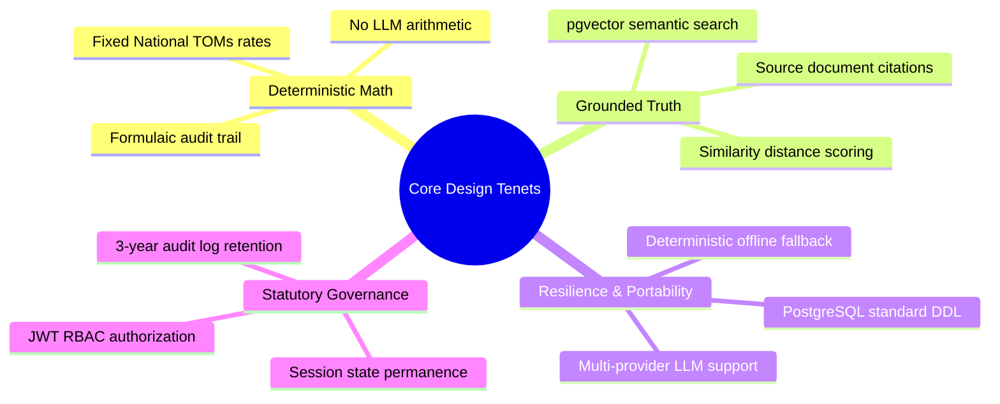
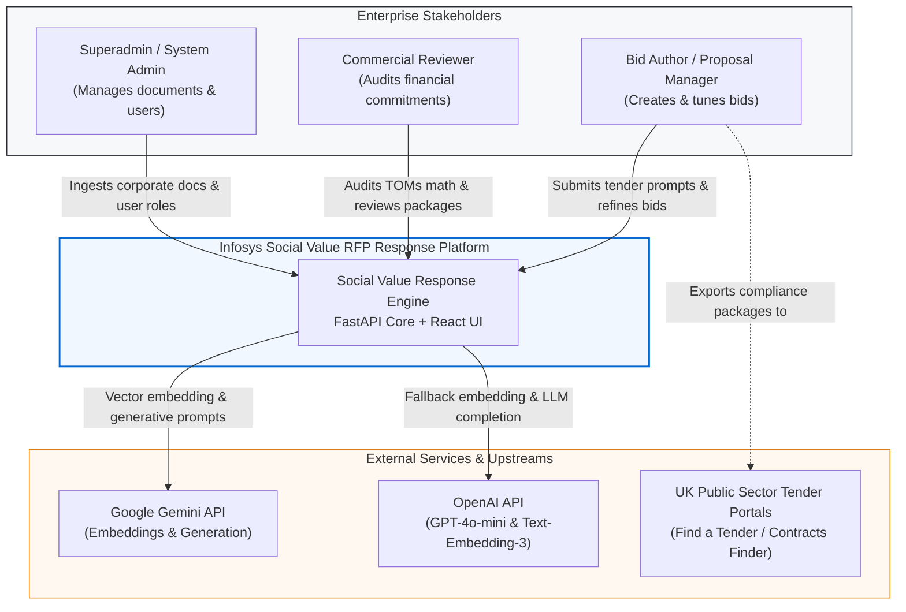
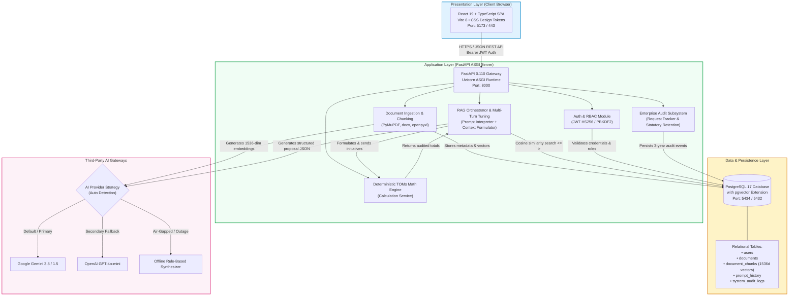
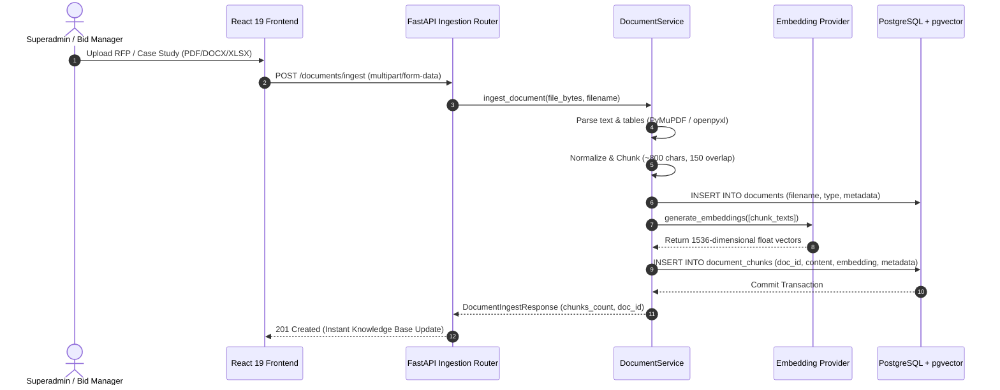
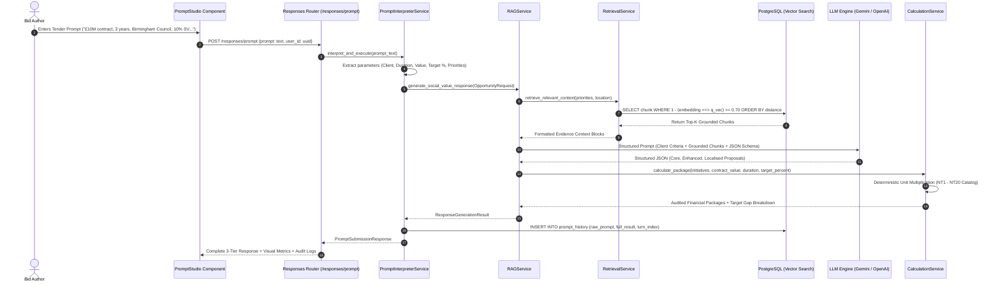
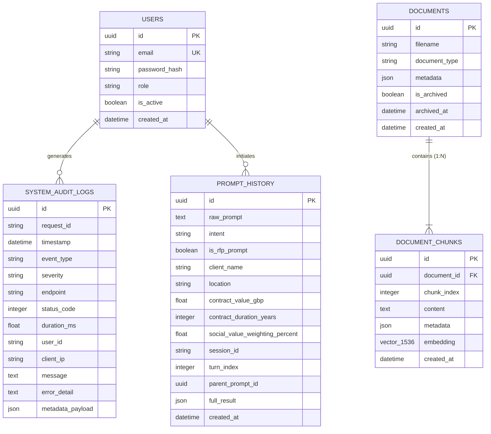

# High-Level Design (HLD) Document
# Infosys Social Value RFP Response Engine

**Document Identifier:** INFOSYS-SV-HLD-2026-V1  
**Project Name:** Social Value RFP Response Builder POC & Enterprise Platform  
**System Classification:** Confidential — Enterprise Decision-Support Architecture  
**Document Version:** 1.0.0  
**Target Audience:** Chief Technology Officers, Enterprise Architects, Bid Directors, Lead Engineers, Security Compliance Officers  
**Date of Release:** October 2026  

---

## Executive Summary & Metadata Control

| Attribute | Specification |
| :--- | :--- |
| **System Name** | Infosys Social Value RFP Response Engine |
| **Primary Domain** | UK Public Sector Procurement (PPN 06/20, Social Value Model, National TOMs) |
| **Primary Frameworks** | FastAPI 0.110+ (Python 3.12+), React 19 + TypeScript + Vite, PostgreSQL 17 + pgvector |
| **AI Infrastructure** | Google Gemini (Gemini 3.8 / 1.5 Flash), OpenAI (GPT-4o-mini), Offline Rule-Based Fallback |
| **Security Standards** | JWT (RFC 7519), PBKDF2 Password Hashing, Role-Based Access Control (RBAC), 3-Year Audit Retention |
| **Deployment Options** | Multi-Container Docker Compose, Azure Container Apps / App Service, Render + Vercel Cloud |

---

## 1. Business Context & Strategic Objectives

### 1.1 UK Public Sector Procurement Regulatory Mandate
In UK public procurement across Central Government Departments, NHS Trusts, and Local Authorities (e.g., Birmingham City Council, Greater Manchester Combined Authority), tenders are evaluated under **Procurement Policy Note (PPN) 06/20** and the **Public Services (Social Value) Act 2012**. 

Social Value is not a generic CSR bullet point; it accounts for **10% to 20% of the total evaluated tender score**. Multi-million-pound contract awards frequently hinge upon the quality, credibility, and auditable financial commitment of the Social Value proposition.

```text
Typical UK Public Sector Tender Scoring Model:
┌──────────────────────────────┬──────────────────────────────┬──────────────────────────────┐
│     Commercial / Price       │     Technical / Delivery     │        Social Value          │
│            40%               │            45%               │          10% - 15%           │
└──────────────────────────────┴──────────────────────────────┴──────────────────────────────┘
                                                               ▲
                                               Determines Winning Tenderer
```

### 1.2 Enterprise Pain Points Addressed
1. **Fragmented Evidence Repository**: Bid teams spend 40–80 hours per bid manually searching unindexed shared drives, past tender submissions, and CSR brochures.
2. **Generative AI Hallucination & Financial Liability**: Standard LLMs fabricate metrics, invent non-existent charities, and commit companies to impossible numerical deliverables. In public tenders, submitted figures become contractually binding Key Performance Indicators (KPIs).
3. **Localisation Deficit**: Local councils strictly penalize generic national initiatives. Bids require ward-level alignment, local college partnerships, and targeted demographic interventions.

### 1.3 Key Architectural Objectives
- **Zero Arithmetic Hallucination**: Strict separation of AI narrative reasoning from deterministic financial mathematics.
- **Evidence-Grounded RAG (Retrieval-Augmented Generation)**: 100% of generated commitments trace directly back to verified past delivery records and certified rate cards.
- **Sub-Second Knowledge Retrieval**: Vector similarity matching across tens of thousands of chunks via `pgvector` indexing.
- **Enterprise Governance & Auditability**: Complete audit logs retained for 3 years (1,095 days) to comply with statutory procurement scrutiny.

---

## 2. Architectural Principles & Guiding Tenets



1. **Deterministic Calculation Decoupling**: Large Language Models structure initiatives, narrative text, and operational scopes. Mathematical multiplication (`Annual Volume × Contract Duration × Proxy Unit Value`) is strictly executed by Python's deterministic runtime.
2. **Multi-Tier Package Formulation**: Every RFP query automatically synthesizes three distinct delivery tiers:
   - **Core Package**: Baseline contractual obligations, proven delivery, lowest risk.
   - **Enhanced Package**: High-impact, elevated initiatives exceeding target Social Value weighting.
   - **Localised Package**: Deep geographic alignment featuring local colleges, charities, and targeted demographics.
3. **Resilient Multi-Provider Strategy**: Seamless auto-fallback across Google Gemini, OpenAI, and a self-contained offline rule-based heuristic engine when network or API quotas fail.
4. **Permanent Knowledge Indexing**: Uploaded knowledge bases are persistently vectorized into PostgreSQL. No redundant re-indexing is required between system reboots or deployment updates.

---

## 3. System Context & Stakeholder Boundaries (C4 Level 1)

The following diagram illustrates the external actors, third-party AI services, and boundary interfaces surrounding the platform.



---

## 4. Container Architecture (C4 Level 2)

The system is decomposed into three primary runtime containers: the Single Page Application (SPA), the Application Backend (FastAPI ASGI), and the Persistent Relational Vector Database (PostgreSQL + pgvector).



---

## 5. Core Subsystem Decomposition

### 5.1 Document Ingestion & Parsing Subsystem
- **Purpose**: Ingest heterogeneous organizational knowledge assets (past winning bids, CSR annual reviews, TOMs unit rate schedules, partnership MOUs).
- **Supported Formats**: `.pdf`, `.docx`, `.xlsx`, `.txt`, `.md`.
- **Parsing Engines**:
  - `PyMuPDF` (`fitz`): High-speed PDF text, page coordinate, and table stream extraction.
  - `python-docx`: Heading hierarchy, body paragraphs, and structured table reading.
  - `openpyxl`: Numerical rate cards, unit descriptions, and proxy metrics.
- **Chunking Pipeline**: Sliding window semantic chunking (~800 characters with 150-character overlap) ensuring semantic continuity across chunk boundaries.

### 5.2 Embedding & Semantic Search Subsystem
- **Vector Space**: 1,536-dimensional normalized hypersphere.
- **Storage**: PostgreSQL `vector(1536)` column managed via `pgvector.sqlalchemy`.
- **Indexing & Distance Operator**: Cosine distance operator (`<=>`) evaluating angular similarity:
  $$\text{Cosine Similarity}(u, v) = 1 - \frac{u \cdot v}{\|u\|_2 \|v\|_2}$$
- **Query Optimization**: Pre-filtering by archival status (`is_archived = false`) and candidate scoring threshold ($\ge 0.70$).

### 5.3 Prompt Interpreter & Multi-Turn Tuning Subsystem
- **Natural Language Intent Recognition**: Analyzes arbitrary user inputs to distinguish between valid RFP tender specifications and non-RFP conversational dialogue.
- **Entity & Parameter Extraction**: Automatically parses:
  - Client Entity (e.g., "Birmingham City Council")
  - Geographic Scope (e.g., "Birmingham, West Midlands")
  - Contract Value (e.g., "£10,000,000")
  - Contract Duration (e.g., "3 Years")
  - Social Value Target Weighting (e.g., "10%")
  - Focal Priority Themes (e.g., `["digital inclusion", "youth employment"]`)
- **Multi-Turn Context State**: Persists conversation session threads in `prompt_history` with parent-child pointers (`turn_index`, `parent_prompt_id`) allowing incremental refinement prompts without loss of prior constraints.

### 5.4 Deterministic TOMs Calculation & Auditing Subsystem
- **Regulatory Framework**: National TOMs (Themes, Outcomes, and Measures) Framework.
- **Mathematical Invariant**:
  $$\text{Initiative Social Value (\pounds)} = \text{Annual Volume} \times \text{Duration (Years)} \times \text{Proxy Unit Value (\pounds)}$$
- **Package Aggregation & Compliance Scoring**:
  $$\text{Total Package SV (\pounds)} = \sum_{i=1}^{N} \text{Initiative SV}_i$$
  $$\text{Achieved SV Percentage (\%)} = \left( \frac{\text{Total Package SV}}{\text{Contract Value}} \right) \times 100$$
  $$\text{Target Deficit / Surplus (\pounds)} = \text{Total Package SV} - (\text{Contract Value} \times \text{Target \%})$$
- **Audit Verification**: Every numerical line item generates an immutable audit trace string (e.g., `[NT8] Digital Inclusion Workshops: 12.0 workshops/yr × 3 yrs = 36.0 workshops @ £1,250.00 = £45,000.00`).

### 5.5 Authentication, RBAC & Enterprise Security Subsystem
- **Authentication Protocol**: RFC 7519 JSON Web Tokens (JWT) signed using HMAC-SHA256 (`HS256`).
- **Password Protection**: PBKDF2 with SHA-256 (310,000 iterations and 16-byte random cryptographic salt).
- **Role-Based Access Control (RBAC)**:
  - `superadmin`: Unrestricted access — document ingestion, archive/delete, user provisioning, audit inspection, statutory log purge.
  - `bid_author`: Prompt engineering, proposal formulation, multi-turn refinement, report export.
  - `reviewer`: Read-only audit verification, financial gap inspection, compliance scoring.

### 5.6 Enterprise Audit & Statutory Compliance Subsystem
- **Compliance Requirement**: Public Contracts Regulations 2015 and PPN 06/20 require a verifiable 3-year audit trail for public procurement submissions.
- **Data Logged**: Request IDs, execution timestamp, client IP, endpoint route, HTTP status code, millisecond processing latency, error stacks, and parameter snapshots.
- **Statutory Purge Policy**: Enforces a strict 1,095-day ceiling with scheduled/on-demand purge routines for expired records.

---

## 6. End-to-End System Workflows

### 6.1 Workflow 1: Document Ingestion & Vector Indexing



---

### 6.2 Workflow 2: Natural Language RFP Prompt Submission & 3-Tier Package Formulation



---

## 7. High-Level Data Architecture & Storage Topology



---

## 8. Non-Functional Requirements (NFR) & Quality Attributes

| Quality Attribute | Target Metric | Architectural Strategy |
| :--- | :--- | :--- |
| **Response Latency** | Vector Search: $< 150\text{ ms}$<br/>Full RAG Generation: $< 3.5\text{ s}$ | In-database pgvector cosine indexing; stream pipeline parsing; single-pass LLM JSON structuring. |
| **Arithmetic Integrity** | 100% Deterministic (Zero Error) | Complete isolation of math calculations from LLM; Python IEEE-754 precision math. |
| **Availability** | 99.9% Production Uptime | Stateless ASGI workers; autonomous failover from Gemini $\to$ OpenAI $\to$ Offline Engine. |
| **Security & Privacy** | OWASP Top 10 Compliant | PBKDF2 cryptographic salt hashing; JWT expiration; parameterized SQL queries (no SQL injection). |
| **Statutory Retention** | 1,095 Days (3 Years) | Automatic timestamp indexing on `system_audit_logs`; bulk purge routine for expired records. |
| **Data Portability** | Zero Vendor Lock-in | Standard PostgreSQL storage; agnostic embedding schema (1536 dimensions); standard Pydantic models. |

---

## 9. Infrastructure & Deployment Topology

### 9.1 Containerized Docker Architecture
The application is packaged as self-contained Docker containers orchestrated via `docker-compose.yml`:
1. **Frontend Service**: Multi-stage build (Node 20 Alpine builder $\to$ Nginx Alpine edge server serving compiled SPA assets).
2. **Backend Service**: Python 3.12 Slim base image running Uvicorn ASGI workers.
3. **Database Service**: Official `pgvector/pgvector:pg17` image with persistent Docker volume storage.

### 9.2 Enterprise Cloud Deployment Options
- **Azure Commercial Cloud**: Azure Container Apps (Backend + Frontend) + Azure Database for PostgreSQL Flexible Server with `pgvector` enabled.
- **Micro-PaaS (Render + Vercel)**: Managed FastAPI Web Service on Render with managed PostgreSQL; zero-config Edge CDN deployment on Vercel for React SPA.

---

## 10. Architectural Risks & Mitigations

| Identified Risk | Impact | Architectural Mitigation Strategy |
| :--- | :--- | :--- |
| **LLM Provider API Outage** | High | System implements triple-tier auto-detection (`Settings.active_provider`). If Gemini is unavailable, it immediately falls back to OpenAI; if both fail, the offline grounded heuristic engine fulfills the bid request. |
| **Token Context Overflow** | Medium | Chunks are sized to ~800 characters. Top-K retrieval selects the top 5 most relevant chunks ($< 4,000$ characters total), occupying $< 10\%$ of modern LLM context windows. |
| **Commercial Rate Inaccuracy** | Critical | National TOMs unit rates are governed via a single version-controlled configuration catalog (`SYNTHETIC_TOMS_CATALOG`). Rates are never parsed or derived dynamically from unverified LLM text. |
