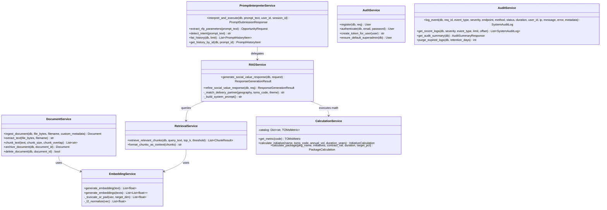
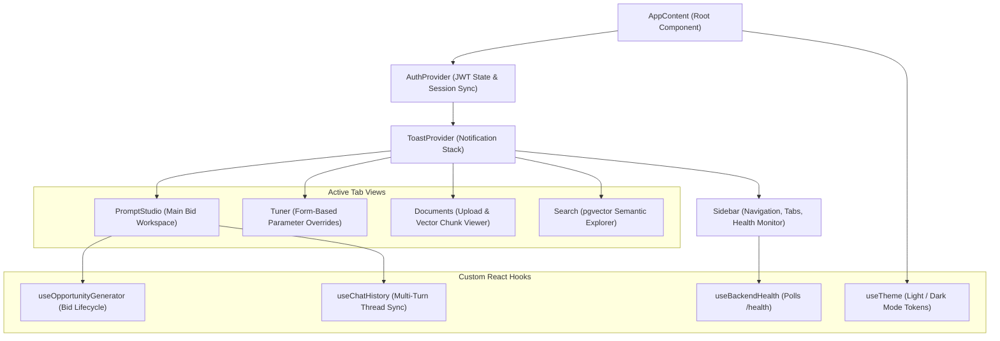

# Low-Level Design (LLD) Document
# Infosys Social Value RFP Response Engine

**Document Identifier:** INFOSYS-SV-LLD-2026-V1  
**Project Name:** Social Value RFP Response Builder POC & Enterprise Platform  
**System Classification:** Confidential — Enterprise Engineering Specifications  
**Document Version:** 1.0.0  
**Target Audience:** Software Engineers, Backend Developers, Frontend Developers, QA Automation Engineers, DevOps Engineers  
**Date of Release:** October 2026  

---

## 1. Document Control & Scope

This Low-Level Design (LLD) document provides exhaustive implementation specifications for the **Infosys Social Value RFP Response Engine**. It specifies exact class structures, database schemas, Data Definition Language (DDL), API contracts, mathematical algorithms, sequence flows, and error handling mechanisms implemented in both the FastAPI backend (`social-value-infoproj`) and the React 19 frontend (`Frontend-Social-value`).

---

## 2. Detailed Module & Component Architecture (C4 Level 3 & 4)



---

## 3. Database Schema & PostgreSQL DDL Specifications

The platform requires **PostgreSQL 15+ (v17 recommended)** with the `pgvector` extension installed. All primary keys utilize RFC 4122 UUIDs.

```sql
-- 1. Enable pgvector Extension
CREATE EXTENSION IF NOT EXISTS "uuid-ossp";
CREATE EXTENSION IF NOT EXISTS vector;

-- 2. Users Table (Authentication & RBAC)
CREATE TABLE IF NOT EXISTS users (
    id UUID PRIMARY KEY DEFAULT gen_random_uuid(),
    name VARCHAR(120) NOT NULL,
    email VARCHAR(255) UNIQUE NOT NULL,
    password_hash VARCHAR(255) NOT NULL,
    role VARCHAR(50) NOT NULL DEFAULT 'superadmin', -- 'superadmin', 'bid_author', 'reviewer'
    is_active BOOLEAN NOT NULL DEFAULT TRUE,
    created_at TIMESTAMP WITHOUT TIME ZONE NOT NULL DEFAULT (NOW() AT TIME ZONE 'UTC')
);

CREATE INDEX IF NOT EXISTS idx_users_email ON users(email);

-- 3. Documents Table (Source Knowledge Assets)
CREATE TABLE IF NOT EXISTS documents (
    id UUID PRIMARY KEY DEFAULT gen_random_uuid(),
    filename VARCHAR(255) NOT NULL,
    document_type VARCHAR(50) NOT NULL, -- 'pdf', 'docx', 'xlsx', 'txt', 'md'
    metadata JSONB DEFAULT '{}'::jsonb,
    is_archived BOOLEAN NOT NULL DEFAULT FALSE,
    archived_at TIMESTAMP WITHOUT TIME ZONE,
    created_at TIMESTAMP WITHOUT TIME ZONE NOT NULL DEFAULT (NOW() AT TIME ZONE 'UTC')
);

CREATE INDEX IF NOT EXISTS idx_documents_archived ON documents(is_archived);
CREATE INDEX IF NOT EXISTS idx_documents_created_at ON documents(created_at DESC);

-- 4. Document Chunks Table (1536-Dimensional Vector Store)
CREATE TABLE IF NOT EXISTS document_chunks (
    id UUID PRIMARY KEY DEFAULT gen_random_uuid(),
    document_id UUID NOT NULL REFERENCES documents(id) ON DELETE CASCADE,
    chunk_index INTEGER NOT NULL,
    content TEXT NOT NULL,
    metadata JSONB DEFAULT '{}'::jsonb,
    embedding vector(1536),
    created_at TIMESTAMP WITHOUT TIME ZONE NOT NULL DEFAULT (NOW() AT TIME ZONE 'UTC')
);

CREATE INDEX IF NOT EXISTS idx_chunks_document_id ON document_chunks(document_id);
-- HNSW / IVFFlat Cosine Distance Index for High-Speed Approximate Nearest Neighbor Matching
CREATE INDEX IF NOT EXISTS idx_chunks_embedding_cosine 
ON document_chunks USING ivfflat (embedding vector_cosine_ops) WITH (lists = 100);

-- 5. Prompt History Table (Multi-Turn Chat & Tuning Memory)
CREATE TABLE IF NOT EXISTS prompt_history (
    id UUID PRIMARY KEY DEFAULT gen_random_uuid(),
    raw_prompt TEXT NOT NULL,
    intent VARCHAR(50) NOT NULL DEFAULT 'rfp_opportunity',
    is_rfp_prompt BOOLEAN NOT NULL DEFAULT TRUE,
    client_name VARCHAR(255),
    location VARCHAR(100),
    contract_value_gbp DOUBLE PRECISION,
    contract_duration_years INTEGER,
    social_value_weighting_percent DOUBLE PRECISION,
    priorities JSONB DEFAULT '[]'::jsonb,
    session_id VARCHAR(100),
    turn_index INTEGER NOT NULL DEFAULT 1,
    parent_prompt_id UUID,
    explanation TEXT,
    response_summary JSONB,
    full_result JSONB,
    created_at TIMESTAMP WITHOUT TIME ZONE NOT NULL DEFAULT (NOW() AT TIME ZONE 'UTC')
);

CREATE INDEX IF NOT EXISTS idx_prompt_history_session ON prompt_history(session_id);
CREATE INDEX IF NOT EXISTS idx_prompt_history_created_at ON prompt_history(created_at DESC);

-- 6. System Audit & Compliance Logs Table (3-Year Statutory Retention)
CREATE TABLE IF NOT EXISTS system_audit_logs (
    id UUID PRIMARY KEY DEFAULT gen_random_uuid(),
    request_id VARCHAR(64) NOT NULL,
    timestamp TIMESTAMP WITHOUT TIME ZONE NOT NULL DEFAULT (NOW() AT TIME ZONE 'UTC'),
    event_type VARCHAR(50) NOT NULL DEFAULT 'API_REQUEST', -- 'API_REQUEST', 'ERROR_EXCEPTION', 'TENDER_GEN'
    severity VARCHAR(20) NOT NULL DEFAULT 'INFO',         -- 'INFO', 'WARNING', 'ERROR', 'CRITICAL'
    endpoint VARCHAR(255),
    method VARCHAR(10),
    status_code INTEGER,
    duration_ms DOUBLE PRECISION,
    user_id VARCHAR(100),
    client_ip VARCHAR(50),
    message TEXT NOT NULL,
    error_detail TEXT,
    metadata_payload JSONB
);

CREATE INDEX IF NOT EXISTS idx_audit_timestamp ON system_audit_logs(timestamp DESC);
CREATE INDEX IF NOT EXISTS idx_audit_request_id ON system_audit_logs(request_id);
CREATE INDEX IF NOT EXISTS idx_audit_severity ON system_audit_logs(severity);
CREATE INDEX IF NOT EXISTS idx_audit_event_type ON system_audit_logs(event_type);
```

---

## 4. Subsystem Detailed Logic & Component Specifications

### 4.1 Document Ingestion & Chunking (`app.services.document_service`)
The `DocumentService` processes binary payloads in memory:
1. **Extraction Dispatcher**:
   - `pdf`: Uses `fitz.open(stream=file_bytes, filetype="pdf")`, iterates pages, extracts plain text streams.
   - `docx`: Uses `docx.Document(io.BytesIO(file_bytes))`, extracts paragraph text and table cell contents.
   - `xlsx`: Uses `openpyxl.load_workbook(io.BytesIO(file_bytes), data_only=True)`, traverses sheets, formats tabular rows into structured markdown lines.
2. **Text Normalization**: Strips excessive whitespace, normalizes Unicode symbols (e.g., standardizing `£` currency symbols), and condenses multi-line carriage returns.
3. **Sliding Window Chunking Algorithm**:
   - Window size: `chunk_size = 800` characters.
   - Window step / overlap: `chunk_overlap = 150` characters.
   - Boundary heuristic: Chunk breaks search backwards for sentence end delimiters (`.\n`, `.\s`, `\n\n`) within the last 80 characters to prevent splitting numerical statements or TOMs codes mid-sentence.

### 4.2 Vector Normalization & Embedding Service (`app.services.embedding_service`)
Embeddings require consistent unit length and dimension for cosine distance comparisons:
- **Vector Dimension**: Strictly fixed to $1,536$.
- **L2 Unit Normalization**:
  $$\hat{v}_i = \frac{v_i}{\sqrt{\sum_{k=1}^{D} v_k^2}}$$
- **SafeVector Type Processor**: In `app.models.chunk.SafeVector`, handles PostgreSQL binary-to-Python float conversion, preventing serialization exceptions when reading pgvector records into NumPy or Pydantic.

### 4.3 Context-Aware RAG Engine (`app.services.rag_service`)
The RAG orchestrator executes a multi-stage assembly:
1. **Semantic Query Assembly**: Combines client name, priorities, and geography into a target embedding search string (e.g., `"Social Value initiatives for Birmingham City Council in Birmingham focusing on digital inclusion youth employment"`).
2. **pgvector Cosine Search**:
   ```python
   # SQLAlchemy Vector Cosine Distance
   stmt = select(
       DocumentChunk,
       DocumentChunk.embedding.cosine_distance(query_vector).label("distance")
   ).join(Document).where(
       Document.is_archived.is_(False)
   ).order_by("distance").limit(top_k)
   ```
3. **Evidence Ranking**: Chunks are mapped to similarity scores:
   $$\text{Score} = 1.0 - \text{distance}$$
   Chunks with $\text{Score} < 0.70$ are discarded as noise.

### 4.4 Prompt Interpreter & Parameter Extractor (`app.services.prompt_interpreter_service`)
Extracts structured parameters from arbitrary free-text natural language:
- **Regex Extraction Rules**:
  - Contract Value: `(?:£|GBP\s*)(\d+(?:\.\d+)?)\s*(k|m|million|thousand)?`
  - Contract Duration: `(\d+)\s*(?:-|–|\s)*(?:year|yr|month)`
  - Weighting: `(\d+(?:\.\d+)?)\s*(?:%|percent)\s*(?:social\s*value|sv|weighting)`
  - Known Clients: Pattern dictionary covering UK authorities (`birmingham`, `manchester`, `leeds`, `london`, `nhs`, `dwp`, `hmrc`).
- **Turn Context Windowing**: For multi-turn refinements (`/responses/refine`), the service preserves the previous `ResponseGenerationResult` and applies the user's delta feedback (e.g., *"Double the digital workshops and add St Basils as a delivery partner"*).

### 4.5 Deterministic TOMs Calculation Engine (`app.services.calculation_service`)
Under no circumstances is arithmetic delegated to generative LLMs.
- **National TOMs Catalog**:
  ```python
  SYNTHETIC_TOMS_CATALOG = {
      "NT1":  {"unit": "weeks",       "unit_value_gbp": 215.00,  "name": "Local Apprenticeship Weeks"},
      "NT3":  {"unit": "people",      "unit_value_gbp": 4850.00, "name": "Young People Supported into Employment (16-24 NEET)"},
      "NT8":  {"unit": "workshops",   "unit_value_gbp": 1250.00, "name": "Digital Inclusion / Skills Workshops"},
      "NT10": {"unit": "hours",       "unit_value_gbp": 45.00,   "name": "Staff Digital & STEM Volunteering Hours"},
      "NT14": {"unit": "GBP spend",   "unit_value_gbp": 0.22,    "name": "Local SME & VCSE Supply Chain Spend Proxy"},
      "NT20": {"unit": "devices",     "unit_value_gbp": 320.00,  "name": "Refurbished Digital Devices Donated"}
  }
  ```
- **Formulas**:
  $$\text{Total Volume} = \text{Annual Volume} \times \text{Duration (Years)}$$
  $$\text{Total Initiative Social Value (\pounds)} = \text{Total Volume} \times \text{Unit Value (\pounds)}$$
  $$\text{Package Achieved SV \%} = \frac{\sum \text{Initiative Social Value}}{\text{Contract Value}} \times 100$$
  $$\text{Target SV (\pounds)} = \text{Contract Value} \times \left( \frac{\text{Target Weighting \%}}{100} \right)$$
  $$\text{Target Met Flag} = \sum \text{Initiative Social Value} \ge \text{Target SV}$$

---

## 5. Detailed REST API Specifications

### 5.1 Authentication Endpoints

#### `POST /auth/login`
- **Description**: Authenticates user credentials and issues a JWT token.
- **Request Body**:
  ```json
  {
    "email": "admin@infosys.com",
    "password": "admin123"
  }
  ```
- **Response `200 OK`**:
  ```json
  {
    "access_token": "eyJhbGciOiJIUzI1NiIsInR5cCI6IkpXVCJ9...",
    "token_type": "bearer",
    "user": {
      "id": "3fa85f64-5717-4562-b3fc-2c963f66afa6",
      "name": "Default Superadmin",
      "email": "admin@infosys.com",
      "role": "superadmin",
      "is_active": true,
      "created_at": "2026-10-20T10:00:00Z"
    }
  }
  ```

#### `GET /auth/me`
- **Headers**: `Authorization: Bearer <token>`
- **Response `200 OK`**: Returns authenticated user profile.
- **Response `401 Unauthorized`**: Token missing, expired, or invalid.

---

### 5.2 Document Management Endpoints

#### `POST /documents/ingest`
- **Description**: Uploads, extracts, chunks, generates embeddings, and indexes a file.
- **Headers**: `Authorization: Bearer <token>`, `Content-Type: multipart/form-data`
- **Form Data**: `file: <binary_data>` (Supported: `.pdf`, `.docx`, `.xlsx`, `.txt`, `.md`)
- **Response `201 Created`**:
  ```json
  {
    "document_id": "7c9e6679-7425-40de-944b-e07fc1f90ae7",
    "filename": "Infosys_Social_Value_Rate_Card.xlsx",
    "document_type": "xlsx",
    "chunks_created": 14,
    "message": "Document successfully ingested and indexed with pgvector"
  }
  ```

#### `GET /documents`
- **Query Params**: `include_archived: bool = true`
- **Response `200 OK`**: Array of `DocumentResponse` objects with chunk counts.

#### `DELETE /documents/{document_id}`
- **Description**: Permanently purges a document and cascades deletion of its vector chunks.
- **Response `200 OK`**: `{"message": "Document and 14 associated chunks successfully deleted"}`

---

### 5.3 RAG Proposal & Tuning Endpoints

#### `POST /responses/prompt`
- **Description**: Core natural language RFP generation endpoint.
- **Request Body**:
  ```json
  {
    "prompt": "I need to build a Social Value bid response, for a 3-year contract of £10M with 10% Social Value weighting. The client Birmingham City Council in Birmingham wants the Social Value offer to address digital inclusion and youth employment.",
    "user_id": "3fa85f64-5717-4562-b3fc-2c963f66afa6"
  }
  ```
- **Response `200 OK` (`PromptSubmissionResponse`)**:
  ```json
  {
    "prompt_id": "4b68e982-f542-4f3b-8588-3ef7956ef192",
    "intent": "rfp_opportunity",
    "is_rfp_prompt": true,
    "explanation": "Detected valid UK Public Sector Social Value specification.",
    "opportunity_request": {
      "client_name": "Birmingham City Council",
      "location": "Birmingham",
      "contract_value_gbp": 10000000.0,
      "contract_duration_years": 3,
      "social_value_weighting_percent": 10.0,
      "priorities": ["digital inclusion", "youth employment"]
    },
    "result": {
      "opportunity": { ... },
      "packages": [
        {
          "name": "Core Compliance Package",
          "package_type": "core",
          "total_social_value_gbp": 1035000.0,
          "social_value_percentage": 10.35,
          "target_met": true,
          "initiatives": [
            {
              "name": "Digital Inclusion & Skills Workshops",
              "toms_code": "NT8",
              "annual_volume": 120.0,
              "duration_years": 3,
              "total_volume": 360.0,
              "unit_value_gbp": 1250.0,
              "total_social_value_gbp": 450000.0,
              "delivery_partner": "Birmingham Community Matters & West Midlands Digital Device Bank",
              "calculation_formula": "120.0 workshops/yr × 3 yrs = 360.0 workshops @ £1,250.00 = £450,000.00"
            }
          ]
        },
        { "name": "Enhanced Value Package", ... },
        { "name": "Localised Delivery Package", ... }
      ],
      "reasoning_steps": [
        {
          "step_number": 1,
          "title": "Evidence Retrieval",
          "description": "Retrieved 5 chunks from pgvector with similarity 0.89 - 0.96."
        }
      ],
      "generated_at": "2026-10-20T10:05:22Z"
    }
  }
  ```

#### `POST /responses/refine`
- **Description**: Multi-turn conversation refinement endpoint.
- **Request Body**:
  ```json
  {
    "feedback": "Increase the apprenticeship volume by 50% and include St Basils Youth Charity explicitly.",
    "previous_result": { ... },
    "previous_prompt": "...",
    "session_id": "session-xyz",
    "parent_prompt_id": "4b68e982-f542-4f3b-8588-3ef7956ef192",
    "turn_index": 2
  }
  ```

---

### 5.4 Audit & Statutory Compliance Endpoints

#### `GET /audit/logs`
- **Query Params**: `severity`, `event_type`, `limit` (default 50), `offset` (default 0)
- **Response `200 OK`**: List of system audit log items with request IDs and timestamps.

#### `GET /audit/summary`
- **Response `200 OK`**: Aggregated audit metrics and statutory retention status:
  ```json
  {
    "total_logs": 1420,
    "total_errors": 4,
    "errors_last_24h": 0,
    "total_warnings": 12,
    "retention_policy": "3-Year Statutory Compliance (PCR 2015 & PPN 06/20)",
    "retention_days": 1095,
    "oldest_record_timestamp": "2024-03-15T09:12:00Z",
    "system_health": "HEALTHY"
  }
  ```

#### `POST /audit/purge-expired`
- **Query Params**: `retention_days = 1095`
- **Response `200 OK`**: Purges records older than the statutory threshold.

---

## 6. Frontend Component Hierarchy & State Architecture



### 6.1 State Flow in `PromptStudio.tsx`
- **Primary Inputs**: User natural language prompt or tuner form inputs.
- **Package Rendering**:
  - Displays three package columns (`Core`, `Enhanced`, `Localised`).
  - Renders statutory compliance badges (`TARGET MET` in green `#10b981`, `TARGET GAP` in red `#ef4444`).
  - Renders individual TOMs initiatives with unit formula tooltips.
- **Export Formats**: Supports clean JSON serialization and Markdown clipboard generation for instant pasting into Word tender responses.

---

## 7. Algorithms & Core Mathematical Logic

### 7.1 Algorithm 1: Sliding Window Semantic Chunking
```python
def chunk_text(text: str, chunk_size: int = 800, chunk_overlap: int = 150) -> List[str]:
    chunks = []
    start = 0
    total_len = len(text)
    
    while start < total_len:
        end = min(start + chunk_size, total_len)
        if end < total_len:
            # Lookback for sentence boundary
            lookback_zone = text[max(start, end - 80):end]
            boundary_idx = -1
            for delimiter in [".\n", ".\r\n", ".\t", ". ", "\n\n"]:
                pos = lookback_zone.rfind(delimiter)
                if pos > boundary_idx:
                    boundary_idx = pos
            if boundary_idx != -1:
                end = max(start, end - 80) + boundary_idx + 1
        
        chunk = text[start:end].strip()
        if len(chunk) > 30:  # Ignore trivial whitespace fragments
            chunks.append(chunk)
            
        start = end - chunk_overlap if end < total_len else total_len
    return chunks
```

### 7.2 Algorithm 2: Deterministic Social Value Formula
```python
def calculate_package(
    initiatives: List[Dict],
    contract_value: float,
    duration_years: int,
    target_weighting_percent: float
) -> PackageCalculation:
    total_social_value = 0.0
    calculated_items = []
    
    for item in initiatives:
        metric = get_metric(item.get("toms_metric_code"))
        unit_val = metric.unit_value_gbp if metric else 0.0
        annual_vol = float(item.get("annual_volume", 1.0))
        
        tot_vol = round(annual_vol * duration_years, 2)
        init_sv = round(tot_vol * unit_val, 2)
        total_social_value += init_sv
        
        calculated_items.append({
            "name": item["name"],
            "total_volume": tot_vol,
            "unit_value_gbp": unit_val,
            "total_social_value_gbp": init_sv,
            "formula": f"{annual_vol}/yr × {duration_years} yrs = {tot_vol} @ £{unit_val} = £{init_sv}"
        })
        
    total_sv_rounded = round(total_social_value, 2)
    achieved_percent = round((total_sv_rounded / contract_value * 100.0) if contract_value > 0 else 0.0, 2)
    target_amount = round(contract_value * (target_weighting_percent / 100.0), 2)
    target_met = total_sv_rounded >= target_amount
    
    return PackageCalculation(
        total_social_value_gbp=total_sv_rounded,
        social_value_percentage=achieved_percent,
        target_met=target_met,
        initiatives=calculated_items
    )
```

---

## 8. Failure Modes, Error Handling & Recovery

| Failure Mode | Detection Mechanism | Immediate Fallback Action | Recovery / Audit Trail |
| :--- | :--- | :--- | :--- |
| **PostgreSQL Unreachable** | Lifespan DB ping fails on boot | Uvicorn terminates with clear startup log; prevents running in corrupted state. | System admin alert; Docker restart policy triggers container restart. |
| **Gemini API Outage / 429 Quota Exceeded** | `google.api_core.exceptions.GoogleAPIError` caught | Falls back automatically to OpenAI `gpt-4o-mini`. | Warning logged to `system_audit_logs` with severity `WARNING`. |
| **OpenAI Outage / 401 Unauthorized** | `openai.APIConnectionError` caught | Falls back to offline heuristic rule-based template engine. | Response flagged with `is_synthetic = true`; audit logged. |
| **Corrupt / Encrypted File Upload** | `fitz.FileDataError` caught during ingestion | Ingestion returns `422 Unprocessable Entity` with explanatory error message. | Failed request recorded in audit table with client IP and filename. |
| **LLM Output Schema Syntax Error** | JSON parser throws `json.JSONDecodeError` | Regex cleans markdown code fences (````json ... ````); if still invalid, repairs structure via fallback template. | Error logged to `system_audit_logs` with raw LLM response payload. |

---

## 9. Verification, Traceability & Testing Specifications

### 9.1 Test Suite Organization (`social-value-infoproj/tests/`)
- `tests/test_auth.py`: Tests user registration, password verification, invalid login rejection, and JWT expiry.
- `tests/test_calculations.py`: Verifies deterministic multiplication, precision rounding, and National TOMs rate catalog lookup.
- `tests/test_documents.py`: Tests multi-format extraction (PDF, DOCX, XLSX), sliding chunking, and cascaded chunk deletion.
- `tests/test_rag.py`: Verifies pgvector cosine distance queries and prompt interpreter parameter extraction.
- `tests/test_audit.py`: Tests audit log creation, pagination filtering, and 3-year statutory purge execution.

### 9.2 Requirements Traceability Matrix

| Functional Requirement | Design Component | Implementation File | Verification Test |
| :--- | :--- | :--- | :--- |
| **PPN 06/20 Social Value Alignment** | `RAGService` | `app/services/rag_service.py` | `tests/test_rag.py::test_bid_generation` |
| **Deterministic TOMs Calculation** | `CalculationService` | `app/services/calculation_service.py` | `tests/test_calculations.py::test_toms_math` |
| **Heterogeneous Document Ingestion**| `DocumentService` | `app/services/document_service.py` | `tests/test_documents.py::test_docx_xlsx_ingest` |
| **1536d Vector Search** | `RetrievalService` | `app/services/retrieval_service.py` | `tests/test_rag.py::test_pgvector_similarity` |
| **Multi-Turn Conversation Memory** | `PromptInterpreterService` | `app/services/prompt_interpreter_service.py` | `tests/test_rag.py::test_multi_turn_refinement` |
| **3-Year Statutory Audit Retention**| `AuditService` | `app/services/audit_service.py` | `tests/test_audit.py::test_purge_expired` |
| **Role-Based Access Control** | `AuthService` | `app/services/auth_service.py` | `tests/test_auth.py::test_rbac_permissions` |
